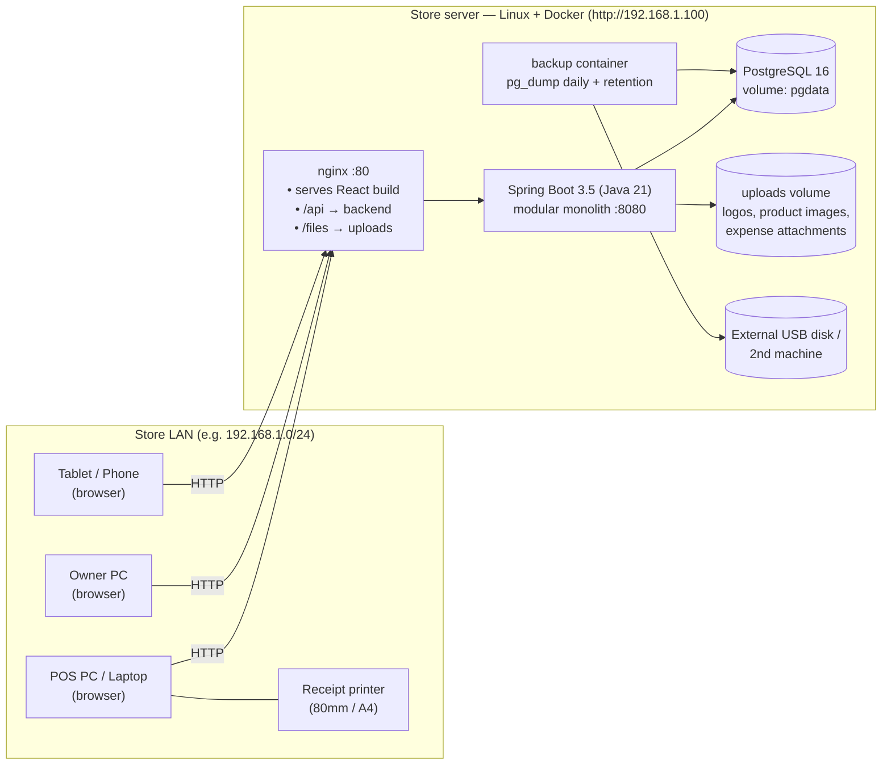

# 01 — System Architecture

Status: **Phase 1, awaiting approval**

## 1. Scope

Store MIS is a LAN-hosted business management system for a single retail/wholesale store
(first client: an electrical appliances shop in Afghanistan). It is generic enough for grocery, clothing,
mobile, hardware and other small and medium-sized stores. It is a **modular monolith**, not an ERP and not
microservices.

Design principles:

1. **Works offline.** Daily operations need no internet. No CDNs, no external fonts, no online APIs.
   Everything (fonts, icons, translations) is bundled.
2. **Ledgers first.** Stock and cash are append-only ledgers (`stock_movements`, `cash_transactions`,
   party ledgers). Cached balances exist for speed and are updated in the same DB transaction, and they
   can always be rebuilt from the ledger.
3. **No silent deletes.** Confirmed documents are never edited or deleted. They are cancelled or
   returned through reversal records that carry a reason, a user and a timestamp.
4. **Historical values are frozen.** Prices, costs, exchange rates and product names are copied onto the
   transaction at posting time.
5. **Exact money.** PostgreSQL `NUMERIC` and Java `BigDecimal` throughout. `float`/`double` are banned
   (an ArchUnit test enforces this on money fields).
6. **Simple for shop staff.** Two roles, a few toggles, keyboard-friendly POS.

## 2. High-level architecture



### Request path

Browser → nginx (static SPA or `/api/**` reverse proxy) → Spring Security filter chain (JWT) →
Controller (validation, DTO mapping) → Service (`@Transactional`, business rules, posting) →
Repository (JPA) → PostgreSQL.

### Backend layering (per module)

```
controller  → REST endpoints, @Valid DTOs, no business logic
service     → business rules, transactions, posting to ledgers, audit calls
repository  → Spring Data JPA + a few native/JPQL queries for reports
entity      → JPA entities (snake_case tables)
dto         → request/response records
mapper      → MapStruct mappers
```

Modules talk to each other **only through service interfaces** (for example `SalesService` calls
`InventoryPostingService.postSale(...)` and `CashPostingService.post(...)`), never through another
module's repositories. Module boundaries are checked with ArchUnit tests.

## 3. Technology stack (pinned at project creation)

| Layer | Choice | Notes |
|---|---|---|
| Language | Java 21 (LTS) | records, pattern matching, virtual threads not needed |
| Framework | Spring Boot **3.5.x** (latest 3.x patch) | Web, Security, Data JPA, Validation, Actuator |
| Auth | Spring Security + JWT (`jjwt` 0.12.x) | access + refresh tokens |
| ORM | Hibernate 6 | `ddl-auto=validate`; schema owned by Flyway |
| Migrations | Flyway | `V001__...sql` style |
| Mapping | MapStruct | |
| API docs | springdoc-openapi 2.x | Swagger UI at `/api/swagger-ui` (Admin-only in prod) |
| Excel export | Apache POI | RTL sheets for fa/ps |
| PDF export | OpenPDF + bundled Vazirmatn font | RTL run direction + Arabic-script shaping (needs a spike in Phase 8) |
| Tests | JUnit 5, Testcontainers (PostgreSQL), ArchUnit | real DB in integration tests |
| Frontend | React 19 + Vite | |
| UI kit | MUI v7 + `@mui/x-data-grid` (MIT) + `@mui/x-date-pickers` | |
| RTL | `stylis-plugin-rtl` + Emotion cache per direction | |
| Routing | React Router v7 | |
| Forms | React Hook Form + Zod resolver | validation messages are i18n keys |
| HTTP | Axios (one instance, interceptors) | |
| Server state | TanStack Query | caching, retries, invalidation |
| App state | React Context (auth, preferences, settings) | no Redux needed |
| i18n | i18next + react-i18next | `en.json`, `fa.json`, `ps.json` |
| Charts | Recharts | theme-aware palette |
| Fonts | Inter (en), Vazirmatn (fa/ps), self-hosted | |
| DB | PostgreSQL 16 | |
| Deploy | Docker Compose, nginx, Ubuntu Server 24.04 LTS | |

## 4. Cross-cutting design decisions

### 4.1 Currencies and exchange rates

- Supported currencies: **AFN** and **USD** (stored in a `currencies` table so more can be added).
- **Base (reporting) currency = AFN.** It is chosen once at setup and locked after the first transaction.
  Inventory cost (weighted average cost), COGS and the P&L are kept in the base currency.
- Every money document (sale, purchase, payment, expense, return, transfer) stores:
  - `currency_code`: the original transaction currency
  - amounts in that currency
  - `exchange_rate`: **base units per 1 unit of the transaction currency**, frozen at posting time
    (1.000000 for AFN; for example 70.500000 for USD)
- The admin keeps the **current rate** in `exchange_rates`. It is copied onto new transactions as the
  default, and authorized users can override it per transaction.
- Old transactions are **never revalued** with today's rate.
- Dashboards and reports show **per-currency totals separately**. A combined figure is shown only as
  "AFN equivalent (at historical rates)" and is labelled that way.
- Cash accounts are per currency (AFN Cash, USD Cash). Moving value between currencies requires a
  **currency exchange** document with an explicit rate.

### 4.2 Inventory costing: weighted average cost (moving average)

- `product_stock` holds `quantity_on_hand`, `avg_unit_cost` (base currency) and `inventory_value`.
- On stock in at cost `c` for quantity `q`:
  `new_value = old_value + q × c`, `new_qty = old_qty + q`, `new_avg = new_value / new_qty`.
- On stock out (sale): cost = `q × current_avg`. The average does not change.
- Each `stock_movements` row records `quantity`, `unit_cost_base`, `quantity_after` and `avg_cost_after`,
  so history can be audited and the stock table can be rebuilt.
- Purchase costs in USD are converted with the purchase's frozen rate. The overall purchase discount is
  spread over the lines pro rata, so the **landed unit cost** is what enters the average.
- Example from the spec: 10 @ 300 + 10 @ 400 → avg 350. Selling 1 @ 500 → COGS 350, gross profit 150.

### 4.3 Concurrency and consistency

- Every posting (sale, purchase, payment, return, adjustment, expense, transfer) runs in **one
  `@Transactional` service call**. Either the document and all its ledger rows commit together, or
  nothing does.
- **Pessimistic row locks** (`SELECT … FOR UPDATE`) on `product_stock` rows (locked in ascending
  `product_id` order to avoid deadlocks), `cash_accounts` rows and `document_sequences` rows. Two
  cashiers can never sell the last unit twice, and cash balances can never drift.
- **Optimistic locking** (`version` column) on editable master data and drafts.
- **Idempotency:** POS confirm, payments and expenses send a client-generated `client_request_id`
  (UUID) with a unique constraint. A retried request after a network drop returns the original document
  instead of creating a duplicate.
- Negative stock and negative cash are **blocked by default** (both are settings).
- A nightly integrity check (also available as an Admin endpoint) compares cached balances with
  ledger sums and reports any mismatch.

### 4.4 Document numbering

`document_sequences` holds one row per document type with prefix, yearly reset and padding. It is
locked `FOR UPDATE` inside the posting transaction, so numbers are gap-free for confirmed documents.
Examples: `INV-2026-000123`, `PUR-2026-000045`, `SRN-2026-000007`, `RCV-2026-000310` (customer receipt),
`PAY-…` (supplier payment), `EXP-…`, `ADJ-…`, `TRF-…`.

### 4.5 Internationalization (en / fa / ps)

- Frontend: i18next with three namespaced JSON files. **No literal UI strings in components**; an ESLint
  rule (`i18next/no-literal-string`) enforces this.
- `fa` and `ps` are **RTL**. Switching language sets `<html dir lang>`, swaps the Emotion cache
  (`stylis-plugin-rtl`), rebuilds the MUI theme with `direction: 'rtl'`, moves the sidebar to the right
  and mirrors directional icons.
- Numbers, money, invoice numbers, product codes and phone numbers are wrapped in a
  `<Ltr>`/`dir="ltr"` span (`unicode-bidi: isolate`) so they stay readable inside RTL text.
  Latin digits are the default. Persian digits are an optional display setting.
- **The backend never returns translated text.** Errors return a stable `code`
  (for example `STOCK_INSUFFICIENT`) plus `params`. Validation errors return field + code. The frontend
  translates them. This covers validation messages in all three languages.
- System seed data (units like *Piece*, expense categories like *Rent*, roles, statuses) has a `code`
  column. The UI translates by code. User-entered names are shown as typed.
- Language preference: `localStorage` for instant load, plus `user_preferences.language` on the server
  so it follows the user after login on any PC. The default for new users is
  `business_settings.default_language`.

### 4.6 Theme

MUI `createTheme` factory built from `(mode, direction)` with the palette from the spec (navy `#172B4D`,
action blue `#2563EB`, and so on). Charts, DataGrid, dialogs and print styles read tokens from the
theme. The preference is stored per user, the same way as language.

### 4.7 Dates and time

- Server timezone **Asia/Kabul**. All timestamps are `timestamptz`.
- Every financial document also stores a `business_date` (`date`), used for daily closing and reports.
- Display calendar: Gregorian by default. A **Solar Hijri (Jalali)** display option is proposed
  (see open questions). It only changes how dates are shown, never how they are stored.

### 4.8 Security

- BCrypt (strength 12) passwords. No public registration. Admin creates users.
- Access JWT (30 min) plus a refresh token (12 h, rotated, stored **hashed** in `refresh_tokens`).
  Logout, deactivation and password reset revoke refresh tokens immediately.
- Login lockout after 5 failed attempts for 15 minutes. All logins, failures and logouts go to the
  audit log.
- Method-level authorization with `@PreAuthorize` (role + permission checks). The UI hides what a user
  cannot use, but the **server is the authority**.
- Uploads: MIME sniffing (Apache Tika), allow-list (png/jpg/webp/pdf), 5 MB limit, random file names,
  stored outside the web root, served through an authorized endpoint.
- CORS is off (same origin through nginx). Security headers are set at nginx. Actuator is limited to
  `health`.

### 4.9 Audit

An `AuditService.log(action, module, entityType, entityId, reference, description, details)` call is
made from services (not controllers). It runs **in the same transaction**, so a rolled-back operation
leaves no false audit entry. Login failures are logged in a separate `REQUIRES_NEW` transaction.

### 4.10 Printing and export

- Receipts and invoices: HTML print templates (80mm thermal, 58mm thermal, A4), rendered by the
  browser with print CSS. This gives the best RTL fidelity and needs no drivers.
- Reports: on-screen paginated tables with a print view, **Excel** (POI) and **PDF** (OpenPDF) generated
  by the backend from the same report query.

## 5. Deployment topology

| Container | Image | Ports | Volumes |
|---|---|---|---|
| `nginx` | nginx:1.27-alpine + React build | 80 (443 optional, self-signed) | — |
| `backend` | eclipse-temurin:21-jre | 8080 (internal only) | `uploads` |
| `db` | postgres:16 | 5432 (internal only) | `pgdata` |
| `backup` | postgres:16 + cron script | — | `backups` (bind-mount to USB/disk) |

Backups: a daily `pg_dump -Fc` plus an uploads tarball. Keep 14 daily, 8 weekly and 12 monthly copies,
and copy them to an external disk. A documented restore script covers restore and verification. Details
come in Phase 9.

## 6. Non-functional targets

| Item | Target |
|---|---|
| Concurrent users | ~2–15 on LAN |
| POS product search | < 150 ms (trigram index on name/code) |
| Sale confirm | < 500 ms |
| Data volume | about 100k sales per year comfortably |
| Browsers | Current Chrome / Edge / Firefox; tablets ≥ 768 px; POS usable ≥ 360 px |
| Availability | Auto-restart containers; UPS recommended for the server |

## 7. Assumptions and open questions (please confirm)

Defaults are in **bold**. I will proceed with them unless you say otherwise.

1. **Base currency** for costing and P&L: **AFN**.
2. **Split payments at POS** (for example, an AFN invoice paid partly in AFN and partly in USD at an
   explicit rate): **supported**.
3. **Solar Hijri calendar display** for fa/ps users: **offered as a setting, Gregorian default**.
4. **Taxes** (BRT/VAT): **not in v1**. Can be added later as an invoice setting.
5. **Barcode scanners**: **supported as keyboard input** in the POS search box (the product code field
   doubles as barcode). No separate barcode table in v1.
6. **Customer opening balances** (existing debts from paper ledgers): **supported** through an
   opening-balance entry. The same applies to suppliers.
7. **Entry User discounts**: **allowed**, controlled by a `GIVE_DISCOUNT` permission.
8. **Selling below cost**: **warning shown**. Blocked only if the setting is enabled.
9. **Cancelling confirmed sales or purchases**: **Admin only**, with a mandatory reason.
10. **Bank accounts**: not requested. `cash_accounts.account_type` allows `BANK` / `HAWALA` later at no
    schema cost.
11. **Product variants** (size/colour): **not in v1**. Each variant is a separate product.
