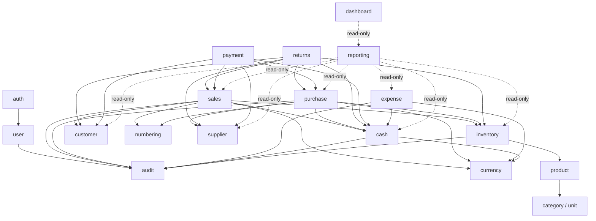

# 02 — Module Breakdown and Roles

## 1. Backend modules

Each module is a Java package under `af.storemis.<module>` with its own entity, repository, service,
controller and DTOs. Arrows show which services a module may call.

| # | Module | Responsibility | Key tables |
|---|---|---|---|
| 1 | **auth** | Login, logout, refresh, JWT issue/validation, lockout, current user (`/me`) | `refresh_tokens` |
| 2 | **user** | Users CRUD, activate/deactivate, admin password reset, permissions, preferences | `users`, `roles`, `permissions`, `user_permissions`, `user_preferences` |
| 3 | **audit** | Append-only activity log and query | `audit_logs` |
| 4 | **settings** | Business info, logo, system flags, invoice/receipt settings | `business_settings`, `document_sequences` |
| 5 | **currency** | Currencies, exchange rate history, current rate lookup | `currencies`, `exchange_rates` |
| 6 | **numbering** | Locked gap-free document numbers (used internally) | `document_sequences` |
| 7 | **catalog** | Categories and units | `categories`, `units` |
| 8 | **product** | Products, images, search (name/code), active flag | `products` |
| 9 | **inventory** | Stock ledger, cached stock + WAC, opening stock, adjustments, damage, low/out-of-stock, integrity check | `product_stock`, `stock_movements`, `stock_adjustments` |
| 10 | **customer** | Customers (incl. Walk-in), ledger, balances per currency, statements, opening balance | `customers`, `customer_ledger_entries` |
| 11 | **supplier** | Suppliers, ledger, balances, statements, opening balance | `suppliers`, `supplier_ledger_entries` |
| 12 | **sales** | POS, sales drafts (held carts), confirm, invoice, cancel, receipt data | `sales`, `sale_items` |
| 13 | **purchase** | Purchase drafts, confirm, cancel | `purchases`, `purchase_items` |
| 14 | **payment** | Customer receipts and supplier payments with allocation to invoices, reversal | `customer_payments`, `customer_payment_allocations`, `supplier_payments`, `supplier_payment_allocations` |
| 15 | **returns** | Sales returns (sellable/damaged, refund/credit), purchase returns | `sales_returns`, `sales_return_items`, `purchase_returns`, `purchase_return_items` |
| 16 | **cash** | Cash accounts, cash ledger, deposits/withdrawals, transfers and currency exchange, daily closing | `cash_accounts`, `cash_transactions`, `cash_transfers`, `cash_closings` |
| 17 | **expense** | Expense categories, expenses, attachments, void | `expense_categories`, `expenses` |
| 18 | **reporting** | 19 reports, P&L, PDF/Excel export | read-only SQL views/queries |
| 19 | **dashboard** | KPIs, charts, recent lists | read-only |
| 20 | **files** | Secure upload/download | filesystem volume |
| — | **common** | Response envelope, exceptions, error codes, money utilities, base entity, pagination, security utils | — |

## 2. Frontend modules

| Module | Pages |
|---|---|
| auth | Login, Change password |
| dashboard | Dashboard (Admin), My Day (Entry User) |
| sales | POS / New Sale, Sales History, Sale Details & Receipt, Sales Returns (list/new) |
| products | Product List, Product Form, Categories, Units |
| inventory | Stock Overview, Stock Movements, Stock Adjustments, Low Stock |
| purchases | New Purchase, Purchase History, Purchase Details, Purchase Returns |
| customers | Customer List, Customer Details (statement, invoices, payments), Customer Payments |
| suppliers | Supplier List, Supplier Details, Supplier Payments |
| finance | Cash Accounts, Cash Transactions, Transfers & Exchange, Expenses, Daily Cash Closing |
| reports | Report hub + 19 report pages sharing one `ReportPage` shell |
| users | Users, User Form & Permissions, Activity Logs |
| settings | Business, Currency, Invoice, Appearance, Expense Categories |

## 3. Roles and permissions

There are two roles. Admin implicitly has every permission. An Entry User gets the **baseline** plus any
**toggles** the Admin turns on for that user.

### Entry User baseline (always granted)

- Search and view products (without cost prices)
- Create and confirm sales in POS, hold/resume own drafts, print receipts
- Register and edit customers
- View **own** sales and receipts
- View own "My Day" summary

### Configurable toggles (`permissions` table)

| Code | Grants | Default for new Entry User |
|---|---|---|
| `RECEIVE_CUSTOMER_PAYMENTS` | Record customer receipts against invoices | ✅ on |
| `GIVE_DISCOUNT` | Item/overall discounts in POS | ✅ on |
| `RECORD_PURCHASES` | Create/confirm purchases, register suppliers | ❌ off |
| `PAY_SUPPLIERS` | Record supplier payments | ❌ off |
| `RECORD_EXPENSES` | Record expenses | ❌ off |
| `PROCESS_SALES_RETURNS` | Create sales returns | ❌ off |
| `VIEW_COST_PRICES` | See avg cost / margin in POS and stock screens | ❌ off |
| `ADJUST_STOCK` | Stock adjustments / damage entries | ❌ off |
| `VIEW_ALL_SALES` | See everyone's sales, not just own | ❌ off |

### Admin-only (never delegable)

User management, settings, exchange rates, cancellations/reversals of confirmed documents, purchase
returns, cash transfers/exchange/withdrawals, daily cash closing and reopening, financial reports and
P&L, audit logs, opening balances, integrity check.

### Access matrix (summary)

| Area | Admin | Entry User |
|---|---|---|
| Dashboard (financial KPIs) | ✅ | ❌ (sees "My Day") |
| POS / sales | ✅ | ✅ |
| Cancel confirmed sale | ✅ | ❌ |
| Sales returns | ✅ | toggle |
| Products / categories / units edit | ✅ | ❌ (view only) |
| Stock overview | ✅ | ✅ (quantities only unless `VIEW_COST_PRICES`) |
| Stock adjustments | ✅ | toggle |
| Purchases | ✅ | toggle |
| Customers | ✅ | ✅ |
| Customer payments | ✅ | toggle |
| Suppliers / payments | ✅ | toggle |
| Expenses | ✅ | toggle |
| Cash accounts / transfers / closing | ✅ | ❌ |
| Reports & P&L | ✅ | ❌ |
| Users / audit logs / settings | ✅ | ❌ |
| Own preferences (language, theme) | ✅ | ✅ |
