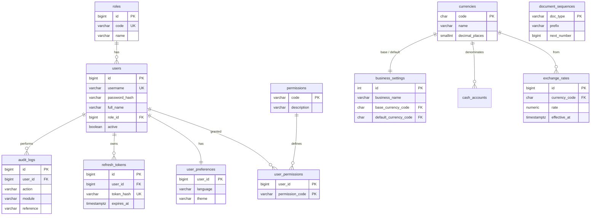
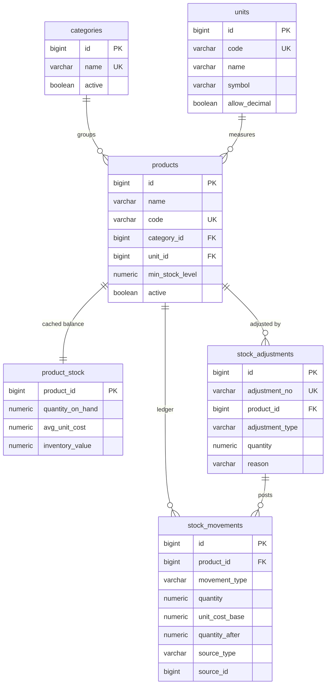
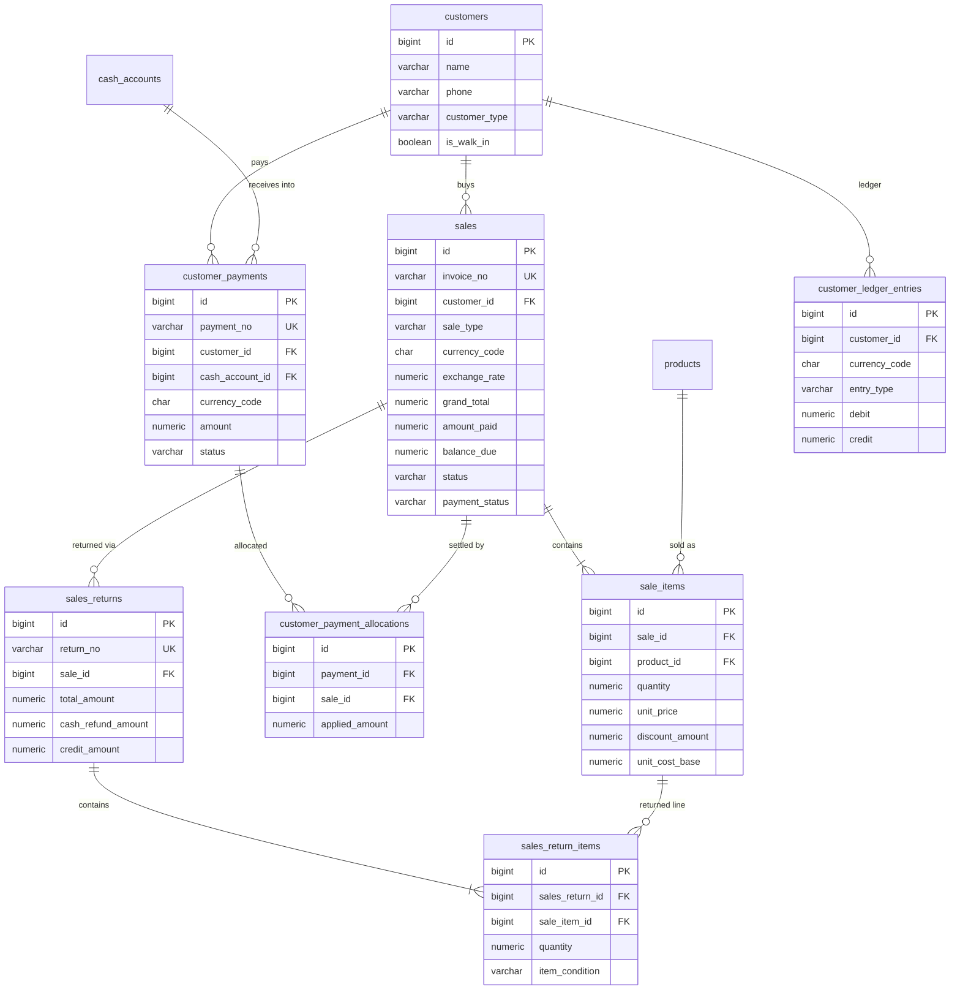
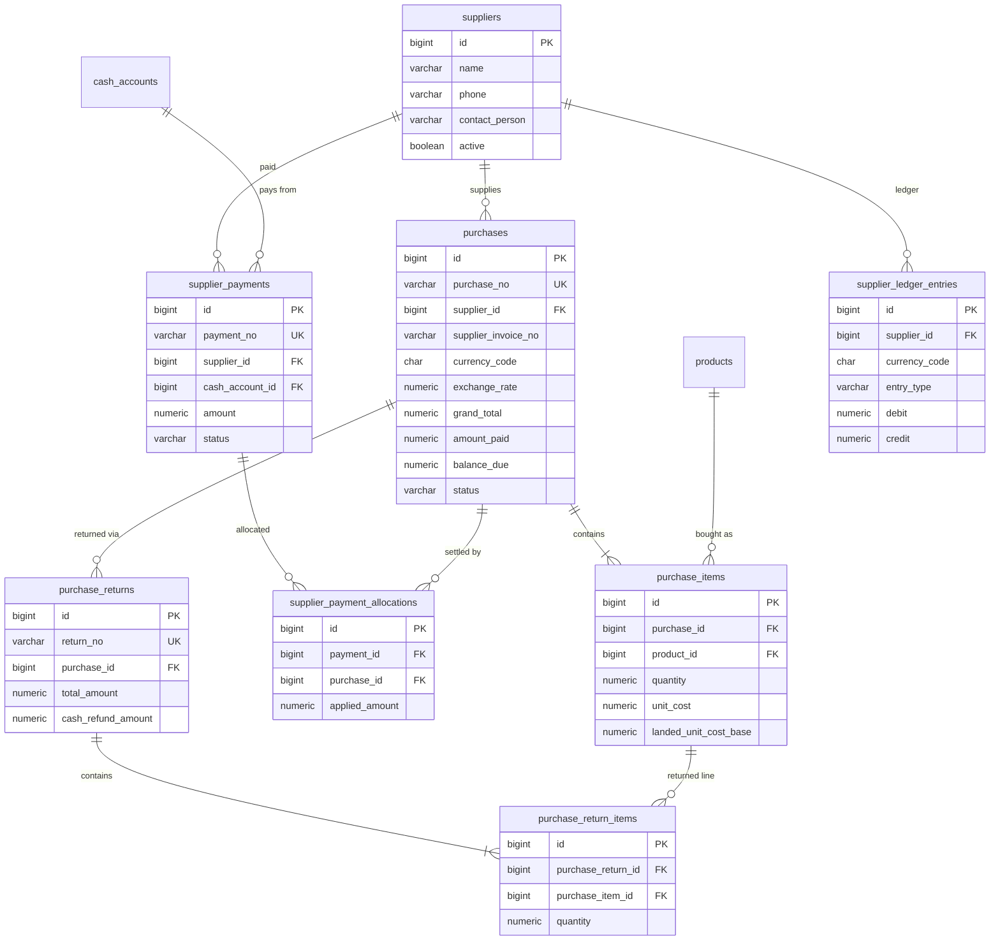
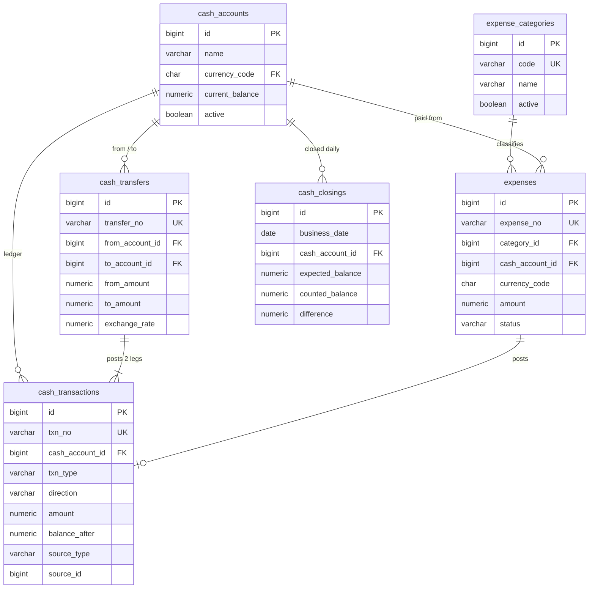

# 03 — Database Design (PostgreSQL 16)

## 1. Conventions

| Topic | Rule |
|---|---|
| Naming | `snake_case`, plural table names, FK columns `<entity>_id` |
| Primary keys | `bigint generated always as identity` (`currencies` uses `code char(3)`) |
| Money (transaction currency) | `numeric(19,2)` |
| Unit cost / base-currency cost | `numeric(19,4)` |
| Exchange rate | `numeric(19,6)`: **base units per 1 unit of the document currency** (AFN = 1) |
| Quantity | `numeric(14,3)` (supports metres, kg, litres; `units.allow_decimal` restricts to integers) |
| Enums | `varchar(30)` + `CHECK` constraint (maps to JPA `EnumType.STRING`) |
| Timestamps | `timestamptz`; documents also carry `business_date date` |
| Audit columns | `created_at`, `created_by → users`, `updated_at`, `updated_by` on mutable tables |
| Optimistic lock | `version int not null default 0` on mutable tables |
| Case-insensitive uniqueness | `unique index on lower(name)` |
| Deletion | Master data is deactivated (`active=false`). Confirmed documents are never deleted. |
| Search | `pg_trgm` GIN indexes on `products.name/code` and `customers.name/phone` |

## 2. ER diagrams

These are split by domain for readability. Every `created_by` / `*_by` column references `users(id)`;
those links are omitted from the diagrams.

### 2.1 Security, settings, currency, audit



### 2.2 Catalog and inventory



### 2.3 Sales, customers, receipts, sales returns



### 2.4 Purchases, suppliers, supplier payments, purchase returns



### 2.5 Cash, expenses, closing



### 2.6 Relationship summary

| Parent | Child | Cardinality | On delete |
|---|---|---|---|
| roles | users | 1 : N | RESTRICT |
| users | user_permissions, user_preferences, refresh_tokens | 1 : N / 1 : 1 | CASCADE (only these three) |
| categories / units | products | 1 : N | RESTRICT |
| products | product_stock | 1 : 1 | RESTRICT |
| products | stock_movements, sale_items, purchase_items, stock_adjustments | 1 : N | RESTRICT |
| customers | sales, customer_payments, customer_ledger_entries, sales_returns | 1 : N | RESTRICT |
| sales | sale_items | 1 : N | RESTRICT (never deleted after confirm; drafts' items are replaced in the service) |
| sales ↔ customer_payments | via customer_payment_allocations | M : N | RESTRICT |
| sales | sales_returns → sales_return_items → sale_items | 1 : N | RESTRICT |
| suppliers | purchases, supplier_payments, supplier_ledger_entries, purchase_returns | 1 : N | RESTRICT |
| purchases ↔ supplier_payments | via supplier_payment_allocations | M : N | RESTRICT |
| currencies | every money table (`currency_code`) | 1 : N | RESTRICT |
| cash_accounts | cash_transactions, payments, expenses, transfers, closings | 1 : N | RESTRICT |
| any document | stock_movements / cash_transactions | polymorphic (`source_type`, `source_id`) | — |

Polymorphic `source_type/source_id` on ledgers is deliberate. It keeps a single ledger per resource.
Integrity is enforced by the posting services, and every ledger row also stores the human-readable
`reference_no`.

## 3. Table definitions

`PK` = primary key, `FK` = foreign key, `UK` = unique, `NN` = not null. Columns marked "audit" are
`created_at timestamptz NN default now()`, `created_by bigint FK users`, `updated_at`, `updated_by`,
`version int NN default 0`.

### 3.1 Security and users

**roles**: seeded `ADMIN`, `ENTRY_USER`
| Column | Type | Constraints |
|---|---|---|
| id | bigint | PK |
| code | varchar(30) | UK NN |
| name | varchar(100) | NN |

**users**
| Column | Type | Constraints / notes |
|---|---|---|
| id | bigint | PK |
| username | varchar(50) | NN, unique on `lower(username)` |
| password_hash | varchar(100) | NN (BCrypt) |
| full_name | varchar(150) | NN |
| phone | varchar(30) | |
| role_id | bigint | FK roles NN |
| active | boolean | NN default true |
| must_change_password | boolean | NN default true (after admin reset) |
| failed_login_attempts | int | NN default 0 |
| locked_until | timestamptz | |
| last_login_at | timestamptz | |
| password_changed_at | timestamptz | |
| *audit* | | |

**permissions**: seeded toggle codes (see doc 02)
| code varchar(50) PK | description varchar(200) |
|---|---|

**user_permissions**
| Column | Type | Constraints |
|---|---|---|
| user_id | bigint | PK, FK users ON DELETE CASCADE |
| permission_code | varchar(50) | PK, FK permissions |
| granted_by / granted_at | bigint / timestamptz | |

**user_preferences**
| Column | Type | Constraints |
|---|---|---|
| user_id | bigint | PK, FK users |
| language | varchar(5) | NN `CHECK in ('en','fa','ps')` |
| theme | varchar(10) | NN `CHECK in ('light','dark')` |
| sidebar_collapsed | boolean | NN default false |
| updated_at | timestamptz | |

**refresh_tokens**
| Column | Type | Constraints |
|---|---|---|
| id | bigint | PK |
| user_id | bigint | FK users NN, index |
| token_hash | varchar(64) | UK NN (SHA-256 of the token) |
| expires_at | timestamptz | NN |
| revoked_at | timestamptz | |
| replaced_by_id | bigint | FK refresh_tokens (rotation chain) |
| created_at / ip_address / user_agent | | |

**audit_logs**: append-only (no UPDATE/DELETE grants for the app role)
| Column | Type | Constraints |
|---|---|---|
| id | bigint | PK |
| occurred_at | timestamptz | NN default now(), index |
| user_id | bigint | FK users (nullable for failed logins) |
| username | varchar(50) | snapshot |
| action | varchar(40) | NN, e.g. `LOGIN`, `LOGIN_FAILED`, `CREATE`, `UPDATE`, `CONFIRM`, `CANCEL`, `REVERSE`, `PAYMENT`, `ADJUST`, `RETURN`, `SETTINGS_CHANGE` |
| module | varchar(30) | NN, index |
| entity_type | varchar(40) | |
| entity_id | bigint | |
| reference | varchar(50) | document number |
| description | varchar(500) | |
| details | jsonb | before/after diff for updates |
| ip_address | varchar(45) | |

Indexes: `(user_id, occurred_at desc)`, `(module, occurred_at desc)`, `(entity_type, entity_id)`.

### 3.2 Settings, numbering, currency

**business_settings**: a single row (`id = 1`, `CHECK (id = 1)`)
| Column | Type | Notes |
|---|---|---|
| business_name | varchar(150) NN | |
| logo_path | varchar(255) | |
| address, phone, email | varchar | |
| base_currency_code | char(3) FK currencies NN | locked after first transaction |
| default_currency_code | char(3) FK currencies NN | |
| default_language | varchar(5) NN default `'en'` | |
| default_theme | varchar(10) NN default `'light'` | |
| calendar_display | varchar(15) NN default `'GREGORIAN'` | `GREGORIAN` / `SOLAR_HIJRI` |
| digit_style | varchar(10) NN default `'LATIN'` | `LATIN` / `PERSIAN` |
| allow_negative_stock | boolean NN default false | |
| allow_negative_cash | boolean NN default false | |
| block_sale_below_cost | boolean NN default false | |
| receipt_format | varchar(15) NN default `'THERMAL_80'` | `THERMAL_80`, `THERMAL_58`, `A4` |
| invoice_header_note / invoice_footer_note | varchar(500) | |
| show_logo_on_receipt | boolean NN default true | |
| timezone | varchar(40) NN default `'Asia/Kabul'` | |
| *audit* | | |

**document_sequences**
| Column | Type | Notes |
|---|---|---|
| doc_type | varchar(30) PK | `SALE`, `PURCHASE`, `SALES_RETURN`, `PURCHASE_RETURN`, `CUSTOMER_PAYMENT`, `SUPPLIER_PAYMENT`, `EXPENSE`, `STOCK_ADJUSTMENT`, `CASH_TRANSFER`, `CASH_TXN` |
| prefix | varchar(10) NN | `INV`, `PUR`, `SRN`, `PRN`, `RCV`, `PAY`, `EXP`, `ADJ`, `TRF`, `CTX` |
| yearly_reset | boolean NN default true | |
| current_year | int NN | |
| next_number | bigint NN default 1 | |
| padding | smallint NN default 6 | |

**currencies**: seeded AFN, USD
| code char(3) PK | name varchar(50) | symbol varchar(5) | decimal_places smallint | active boolean |
|---|---|---|---|---|

**exchange_rates**: history of admin-entered rates (the latest effective rate is the default)
| Column | Type | Notes |
|---|---|---|
| id | bigint PK | |
| currency_code | char(3) FK NN | foreign currency (USD) |
| rate | numeric(19,6) NN `CHECK > 0` | base units per 1 unit |
| effective_at | timestamptz NN | index `(currency_code, effective_at desc)` |
| notes | varchar(200) | |
| created_at / created_by | | |

### 3.3 Catalog

**categories**
| id bigint PK | name varchar(100) NN (unique `lower`) | description varchar(300) | active boolean NN | *audit* |
|---|---|---|---|---|

**units**: seeded with codes `PIECE, BOX, PACKET, METER, KILOGRAM, LITER, SET, ROLL`
| Column | Type | Notes |
|---|---|---|
| id | bigint PK | |
| code | varchar(30) UK | nullable; set only for system units (translated by UI) |
| name | varchar(50) NN | unique `lower` |
| symbol | varchar(10) | `pcs`, `m`, `kg` |
| allow_decimal | boolean NN default false | |
| active | boolean NN | |
| *audit* | | |

**products**
| Column | Type | Notes |
|---|---|---|
| id | bigint PK | |
| name | varchar(200) NN | trigram index |
| code | varchar(60) | **unique where not null** (partial index); doubles as barcode; trigram index |
| category_id | bigint FK NN | |
| unit_id | bigint FK NN | |
| brand | varchar(100) | |
| description | text | |
| min_stock_level | numeric(14,3) | `CHECK >= 0` |
| image_path | varchar(255) | |
| active | boolean NN default true | |
| *audit* | | |

There is **no selling price column**. The price is entered per sale line, and the POS shows the
*last selling price* to this customer and overall as hints.

### 3.4 Inventory

**product_stock**: one row per product (created with the product), locked `FOR UPDATE` on every posting
| Column | Type | Notes |
|---|---|---|
| product_id | bigint PK FK products | |
| quantity_on_hand | numeric(14,3) NN default 0 | `CHECK >= 0` unless negative stock is allowed (enforced in the service) |
| avg_unit_cost | numeric(19,4) NN default 0 | base currency |
| inventory_value | numeric(19,4) NN default 0 | |
| last_movement_at | timestamptz | |
| version | int | |

**stock_movements**: append-only ledger
| Column | Type | Notes |
|---|---|---|
| id | bigint PK | |
| product_id | bigint FK NN | |
| movement_type | varchar(30) NN | `OPENING`, `PURCHASE`, `PURCHASE_CANCEL`, `PURCHASE_RETURN`, `SALE`, `SALE_CANCEL`, `SALE_RETURN`, `ADJUSTMENT_IN`, `ADJUSTMENT_OUT`, `DAMAGE` |
| quantity | numeric(14,3) NN | **signed**: + in, − out, `CHECK <> 0` |
| unit_cost_base | numeric(19,4) NN | cost applied by this movement |
| total_cost_base | numeric(19,4) NN | `quantity × unit_cost_base` (signed) |
| quantity_after | numeric(14,3) NN | running balance |
| avg_cost_after | numeric(19,4) NN | running WAC |
| source_type | varchar(30) NN | `SALE`, `PURCHASE`, `SALES_RETURN`, `PURCHASE_RETURN`, `STOCK_ADJUSTMENT` |
| source_id | bigint NN | |
| source_item_id | bigint | line id |
| reference_no | varchar(30) NN | |
| business_date | date NN | |
| notes | varchar(300) | |
| created_at / created_by | | |

Indexes: `(product_id, id)`, `(business_date)`, `(source_type, source_id)`, `(movement_type, business_date)`.

**stock_adjustments**
| Column | Type | Notes |
|---|---|---|
| id | bigint PK | |
| adjustment_no | varchar(30) UK NN | |
| product_id | bigint FK NN | |
| adjustment_type | varchar(20) NN | `OPENING`, `INCREASE`, `DECREASE`, `DAMAGE` |
| quantity | numeric(14,3) NN `CHECK > 0` | direction comes from the type |
| unit_cost_base | numeric(19,4) | required for `OPENING`/`INCREASE`; system WAC for the others |
| reason | varchar(300) NN | |
| business_date | date NN | |
| created_at / created_by | | |

### 3.5 Customers and suppliers

**customers**
| Column | Type | Notes |
|---|---|---|
| id | bigint PK | |
| name | varchar(150) NN | trigram |
| phone | varchar(30) | index |
| address | varchar(300) | |
| customer_type | varchar(15) NN | `RETAIL` / `WHOLESALE` |
| notes | text | |
| is_walk_in | boolean NN default false | unique partial index `where is_walk_in` (exactly one row, seeded, cannot be deactivated or given credit) |
| active | boolean NN | |
| *audit* | | |

**customer_ledger_entries**: receivable ledger per currency, the basis for statements
| Column | Type | Notes |
|---|---|---|
| id | bigint PK | |
| customer_id | bigint FK NN | |
| currency_code | char(3) FK NN | |
| entry_type | varchar(30) NN | `OPENING_BALANCE`, `SALE`, `PAYMENT`, `SALES_RETURN`, `SALE_CANCEL`, `PAYMENT_REVERSAL`, `CREDIT_REFUND` |
| debit | numeric(19,2) NN default 0 | increases what the customer owes |
| credit | numeric(19,2) NN default 0 | decreases it |
| balance_after | numeric(19,2) NN | running balance for this customer + currency |
| source_type / source_id / reference_no | | |
| business_date | date NN | |
| created_at / created_by | | |

Index `(customer_id, currency_code, id)`. A negative balance means the customer has **credit**.

**suppliers**: same shape as customers, plus `contact_person`, minus `customer_type`/`is_walk_in`.

**supplier_ledger_entries**: mirror of the customer ledger (credit = we owe more; debit = paid/returned).
Entry types: `OPENING_BALANCE`, `PURCHASE`, `PAYMENT`, `PURCHASE_RETURN`, `PURCHASE_CANCEL`,
`PAYMENT_REVERSAL`, `SUPPLIER_REFUND`.

### 3.6 Sales

**sales**
| Column | Type | Notes |
|---|---|---|
| id | bigint PK | |
| invoice_no | varchar(30) | UK, null while `DRAFT` |
| client_request_id | uuid | UK (idempotency) |
| customer_id | bigint FK NN | |
| sale_type | varchar(15) NN | `RETAIL` / `WHOLESALE` |
| sale_date | timestamptz NN | |
| business_date | date NN | index |
| currency_code | char(3) FK NN | |
| exchange_rate | numeric(19,6) NN | frozen |
| subtotal | numeric(19,2) NN | Σ qty × price |
| item_discount_total | numeric(19,2) NN default 0 | |
| overall_discount | numeric(19,2) NN default 0 | |
| grand_total | numeric(19,2) NN | `subtotal − item_discount_total − overall_discount`, `CHECK >= 0` |
| amount_paid | numeric(19,2) NN default 0 | in invoice currency |
| returned_amount | numeric(19,2) NN default 0 | |
| balance_due | numeric(19,2) NN | `grand_total − returned_amount − amount_paid`, `CHECK >= 0` |
| total_cost_base | numeric(19,4) NN default 0 | COGS snapshot |
| status | varchar(15) NN | `DRAFT`, `CONFIRMED`, `CANCELLED` |
| payment_status | varchar(15) NN | `UNPAID`, `PARTIALLY_PAID`, `PAID` |
| notes | varchar(500) | |
| cancelled_at / cancelled_by / cancel_reason | | reason NN when cancelled (CHECK) |
| *audit* | | `created_by` = cashier, index `(created_by, business_date)` |

**sale_items**
| Column | Type | Notes |
|---|---|---|
| id | bigint PK | |
| sale_id | bigint FK NN | |
| line_no | smallint NN | UK `(sale_id, line_no)` |
| product_id | bigint FK NN | |
| product_name | varchar(200) NN | snapshot |
| unit_name | varchar(50) NN | snapshot |
| quantity | numeric(14,3) NN `> 0` | |
| unit_price | numeric(19,2) NN `>= 0` | entered manually |
| discount_amount | numeric(19,2) NN default 0 | line discount |
| line_total | numeric(19,2) NN | `qty × price − discount` |
| overall_discount_share | numeric(19,2) NN default 0 | pro-rata share, used for net revenue and returns |
| unit_cost_base | numeric(19,4) NN | WAC at confirm time |
| line_cost_base | numeric(19,4) NN | |
| returned_quantity | numeric(14,3) NN default 0 | `CHECK <= quantity` |

### 3.7 Customer payments

**customer_payments**
| Column | Type | Notes |
|---|---|---|
| id | bigint PK | |
| payment_no | varchar(30) UK NN | |
| client_request_id | uuid UK | |
| customer_id | bigint FK NN | |
| payment_kind | varchar(15) NN | `AT_SALE` (POS) / `COLLECTION` (later) |
| payment_date / business_date | | |
| currency_code | char(3) FK NN | currency actually handed over |
| amount | numeric(19,2) NN `> 0` | |
| exchange_rate | numeric(19,6) NN | base per 1 unit of payment currency |
| cash_account_id | bigint FK NN | must match `currency_code` |
| unallocated_amount | numeric(19,2) NN default 0 | becomes customer credit |
| status | varchar(15) NN | `POSTED`, `REVERSED` |
| reversed_at / reversed_by / reversal_reason | | |
| notes | varchar(300) | |
| received_by (= created_by), created_at | | |

**customer_payment_allocations**
| Column | Type | Notes |
|---|---|---|
| id | bigint PK | |
| payment_id | bigint FK NN | |
| sale_id | bigint FK NN | |
| applied_amount | numeric(19,2) NN `> 0` | in the **invoice** currency |
| paid_amount | numeric(19,2) NN | portion of the payment, in the **payment** currency |
| cross_rate | numeric(19,6) NN | invoice-currency units per payment-currency unit (1 if same) |

UK `(payment_id, sale_id)`.

### 3.8 Purchases and supplier payments

**purchases**: same money shape as `sales`
| Column | Type | Notes |
|---|---|---|
| id, purchase_no (UK, null while draft), client_request_id | | |
| supplier_id | bigint FK NN | |
| supplier_invoice_no | varchar(50) | index `(supplier_id, supplier_invoice_no)` |
| purchase_date / business_date | | |
| currency_code, exchange_rate | | frozen |
| subtotal, item_discount_total, overall_discount, grand_total | numeric(19,2) | |
| amount_paid, returned_amount, balance_due | numeric(19,2) | |
| status | varchar(15) | `DRAFT`, `CONFIRMED`, `CANCELLED` |
| payment_status | varchar(15) | `UNPAID`, `PARTIALLY_PAID`, `PAID` |
| notes, cancel_*, *audit* | | |

**purchase_items**
| Column | Type | Notes |
|---|---|---|
| id, purchase_id FK, line_no, product_id FK | | |
| quantity | numeric(14,3) `> 0` | |
| unit_cost | numeric(19,4) `>= 0` | document currency |
| discount_amount, line_total | numeric(19,2) | |
| overall_discount_share | numeric(19,2) | |
| landed_unit_cost_base | numeric(19,4) NN | `((line_total − share) / qty) × exchange_rate`; this enters WAC |
| returned_quantity | numeric(14,3) default 0 | `CHECK <= quantity` |

**supplier_payments** / **supplier_payment_allocations**: mirror of the customer tables
(`payment_kind`: `AT_PURCHASE` / `PAYMENT`).

### 3.9 Returns

**sales_returns**
| Column | Type | Notes |
|---|---|---|
| id, return_no UK, client_request_id UK | | |
| sale_id | bigint FK NN | |
| customer_id | bigint FK NN | |
| business_date, return_date | | |
| currency_code, exchange_rate | | **copied from the original sale** |
| total_amount | numeric(19,2) NN | value of returned goods (net of discounts) |
| receivable_reduction | numeric(19,2) NN | part that reduces the invoice balance due |
| cash_refund_amount | numeric(19,2) NN default 0 | |
| refund_cash_account_id | bigint FK | required if refund > 0 |
| credit_amount | numeric(19,2) NN default 0 | left as customer credit |
| reason | varchar(300) NN | |
| status | varchar(15) | `POSTED` |
| *audit* | | `CHECK total = receivable_reduction + cash_refund + credit` |

**sales_return_items**
| Column | Type | Notes |
|---|---|---|
| id, sales_return_id FK, sale_item_id FK, product_id FK | | |
| quantity | numeric(14,3) `> 0` | |
| unit_net_price | numeric(19,4) | from the sale line, after line + overall discount share |
| line_total | numeric(19,2) | |
| item_condition | varchar(10) NN | `SELLABLE` / `DAMAGED` |
| unit_cost_base | numeric(19,4) NN | copied from the sale line |
| reason | varchar(300) | |

**purchase_returns** / **purchase_return_items**: same shape, linked to `purchases`/`purchase_items`
(`payable_reduction`, `cash_refund_amount`, `refund_cash_account_id`, `credit_amount`). No condition
column.

### 3.10 Cash and expenses

**cash_accounts**: seeded "AFN Cash", "USD Cash"
| Column | Type | Notes |
|---|---|---|
| id | bigint PK | |
| name | varchar(100) NN UK | |
| currency_code | char(3) FK NN | |
| account_type | varchar(15) NN default `'CASH'` | `CASH` (future: `BANK`, `HAWALA`) |
| current_balance | numeric(19,2) NN default 0 | cached, locked `FOR UPDATE` |
| is_default | boolean | one default per currency (partial UK) |
| active | boolean | |
| *audit* | | |

**cash_transactions**: append-only ledger
| Column | Type | Notes |
|---|---|---|
| id | bigint PK | |
| txn_no | varchar(30) UK NN | |
| cash_account_id | bigint FK NN | |
| txn_type | varchar(30) NN | `OPENING_BALANCE`, `SALE_RECEIPT`, `CUSTOMER_COLLECTION`, `PURCHASE_PAYMENT`, `SUPPLIER_PAYMENT`, `EXPENSE`, `SALE_REFUND`, `SUPPLIER_REFUND`, `OWNER_DEPOSIT`, `OWNER_WITHDRAWAL`, `TRANSFER_IN`, `TRANSFER_OUT`, `EXCHANGE_IN`, `EXCHANGE_OUT`, `CLOSING_DIFFERENCE`, `REVERSAL` |
| direction | varchar(3) NN | `IN` / `OUT` |
| amount | numeric(19,2) NN `> 0` | |
| balance_after | numeric(19,2) NN | |
| exchange_rate | numeric(19,6) NN | base per unit (for AFN-equivalent reporting) |
| source_type / source_id / reference_no | | |
| reversal_of_id | bigint FK cash_transactions | |
| business_date | date NN | index `(cash_account_id, business_date)` |
| description | varchar(300) | |
| created_at / created_by | | |

**cash_transfers**: same-currency transfers **and** currency exchanges
| Column | Type | Notes |
|---|---|---|
| id, transfer_no UK | | |
| transfer_type | varchar(15) | `TRANSFER` / `EXCHANGE` |
| from_account_id / to_account_id | bigint FK NN | `CHECK from <> to` |
| from_amount / to_amount | numeric(19,2) NN | |
| exchange_rate | numeric(19,6) NN | to-units per from-unit; 1 for a same-currency transfer |
| business_date, notes, *audit* | | |

**expense_categories**: seeded codes `RENT, ELECTRICITY, TRANSPORT, SALARY, MAINTENANCE, INTERNET, OTHER`
| id | code varchar(30) UK nullable | name varchar(100) NN | active | *audit* |
|---|---|---|---|---|

**expenses**
| Column | Type | Notes |
|---|---|---|
| id, expense_no UK, client_request_id UK | | |
| category_id | bigint FK NN | |
| business_date / expense_date | | |
| description | varchar(300) NN | |
| amount | numeric(19,2) NN `> 0` | |
| currency_code, exchange_rate | | |
| cash_account_id | bigint FK NN | currency must match |
| attachment_path | varchar(255) | |
| status | varchar(10) | `POSTED`, `VOIDED` |
| void_reason / voided_at / voided_by | | |
| recorded_by (= created_by), created_at | | |

**cash_closings**
| Column | Type | Notes |
|---|---|---|
| id | bigint PK | |
| business_date | date NN | UK `(business_date, cash_account_id)` |
| cash_account_id | bigint FK NN | |
| opening_balance, total_in, total_out, expected_balance | numeric(19,2) NN | computed from the ledger |
| counted_balance | numeric(19,2) NN | entered by the Admin |
| difference | numeric(19,2) NN | `counted − expected` (posts a `CLOSING_DIFFERENCE` txn if ≠ 0) |
| status | varchar(10) | `CLOSED`, `REOPENED` |
| notes, closed_by, closed_at, reopened_by, reopened_at, reopen_reason | | |

## 4. Key constraints and indexes (summary)

- Unique: all document numbers, `client_request_id`s, `products.code` (partial), usernames, category/unit
  names (case-insensitive), the single Walk-in customer, one default cash account per currency.
- CHECKs: positive quantities and amounts, `balance_due >= 0`, `returned_quantity <= quantity`,
  `cancel_reason` required when `status = 'CANCELLED'`, the totals equation on returns.
- Trigram GIN: `products(name)`, `products(code)`, `customers(name)`, `suppliers(name)`.
- Reporting B-tree: `business_date` on every document and ledger, `(customer_id, business_date)`,
  `(supplier_id, business_date)`, `(product_id, id)` on `stock_movements`.
- DB role: the application user has **no `DELETE`** on ledger, document and audit tables (granted in a
  Flyway migration). Accidental hard deletes fail at the database.

## 5. Flyway migration plan

```
V001__extensions_and_reference.sql        pg_trgm, currencies, roles, permissions
V002__users_auth_audit.sql                users, user_permissions, user_preferences, refresh_tokens, audit_logs
V003__settings_numbering_rates.sql        business_settings, document_sequences, exchange_rates
V004__catalog.sql                         categories, units, products, product_stock
V005__inventory.sql                       stock_movements, stock_adjustments
V006__parties.sql                         customers, suppliers, ledgers
V007__cash_expenses.sql                   cash_accounts, cash_transactions, cash_transfers, expense_categories, expenses, cash_closings
V008__purchases.sql                       purchases, purchase_items, supplier_payments, allocations
V009__sales.sql                           sales, sale_items, customer_payments, allocations
V010__returns.sql                         sales_returns(+items), purchase_returns(+items)
V011__seed_data.sql                       admin user (forced password change), units, expense categories, walk-in customer, AFN/USD cash accounts, sequences
V012__grants.sql                          revoke DELETE on financial tables from app role
```
