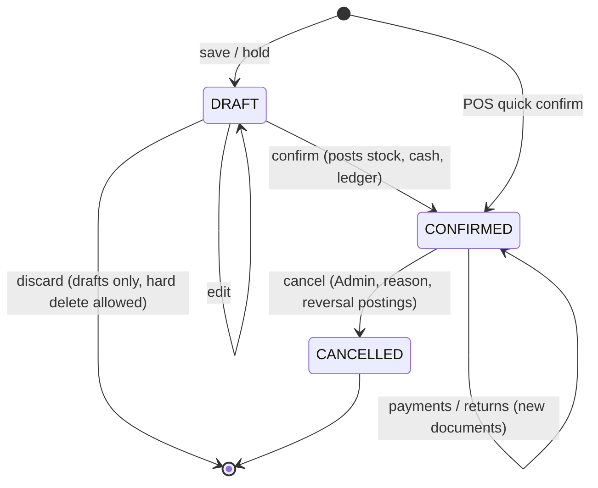
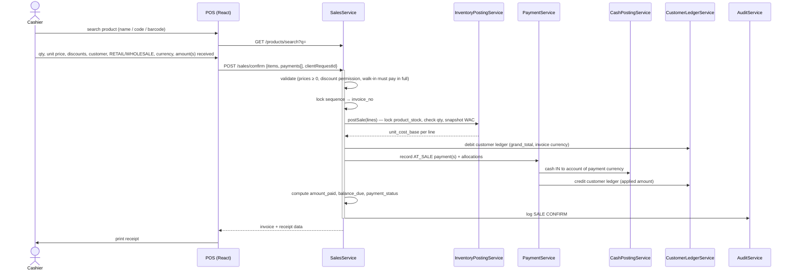
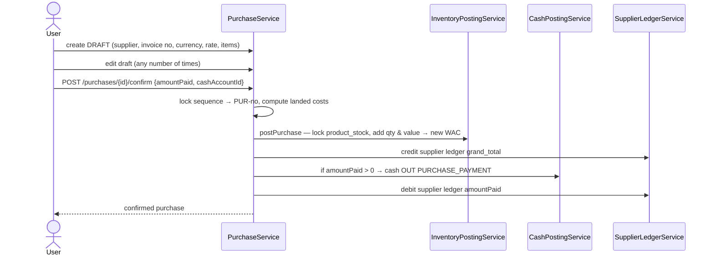
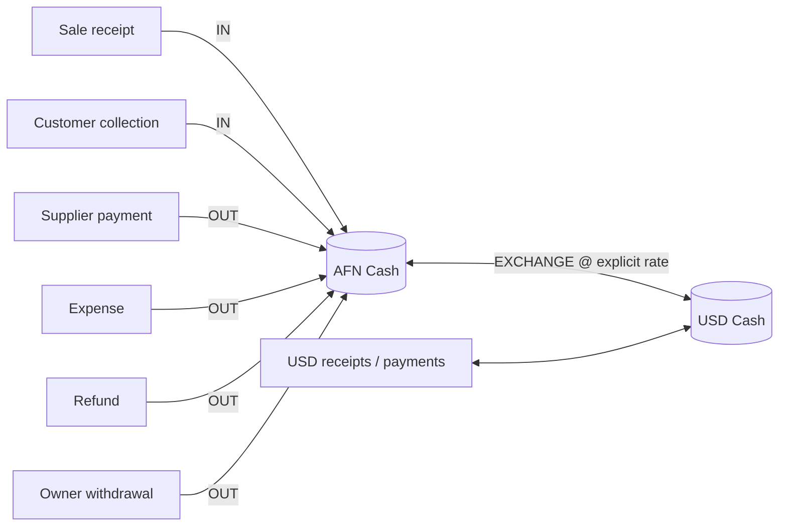

# 04 — Business Workflows and Posting Rules

Every workflow below runs inside **one database transaction** in the service layer. "Lock" means
`SELECT … FOR UPDATE`. The order is always: sequences → product_stock (ascending id) → cash_accounts
(ascending id) → party ledger. A fixed order prevents deadlocks.

Notation: `rate` = document `exchange_rate` (base AFN per 1 unit of the document currency).

## 1. Document lifecycle



Payment status is derived and recalculated after every payment, return or cancel:
`balance_due = grand_total − returned_amount − amount_paid` → `0` = `PAID`; `amount_paid = 0` =
`UNPAID`; otherwise `PARTIALLY_PAID`.

## 2. Sales / POS workflow



### Calculation rules

```
line_gross          = quantity × unit_price
line_total          = line_gross − line_discount
subtotal            = Σ line_gross
item_discount_total = Σ line_discount
grand_total         = subtotal − item_discount_total − overall_discount
overall_discount_share(line) = overall_discount × line_total / Σ line_total   (rounded; remainder goes to the last line)
line_cost_base      = quantity × avg_unit_cost (at confirm)
```

### Postings on confirm

| Ledger | Entry |
|---|---|
| stock_movements | `SALE`, −qty, at current WAC (WAC unchanged), per line |
| product_stock | qty −, value − cost |
| customer_ledger | **debit** `grand_total` (invoice currency) |
| customer_payments (+allocations) | one per payment line actually received |
| cash_transactions | `SALE_RECEIPT` **IN**, only the amount actually received, into that currency's account |
| customer_ledger | **credit** each applied amount |
| sales | `amount_paid`, `balance_due`, `payment_status`, `total_cost_base` |

Revenue = `grand_total` (not the cash received). COGS = `total_cost_base`. The receivable is the
customer ledger balance. Cash only grows by what was actually received.

### Worked example (spec case)

Invoice AFN 10,000, received AFN 6,000:

- Customer ledger: debit 10,000, credit 6,000 → balance 4,000 AFN.
- AFN Cash +6,000. `payment_status = PARTIALLY_PAID`, `balance_due = 4,000`.
- Later a collection of AFN 4,000 → `RCV-…`, AFN Cash +4,000, ledger credit 4,000, status `PAID`.

### Split / cross-currency payment

AFN invoice of 14,000, customer pays USD 100 at rate 70 plus AFN 7,000:

- Payment 1: USD 100 → **USD Cash +100**. Allocation `applied_amount` = 7,000 AFN, `cross_rate` = 70.
- Payment 2: AFN 7,000 → AFN Cash +7,000. Applied 7,000.
- Result: invoice fully paid. Each cash account grows in its own currency.

### Rules

- Walk-in customer: `balance_due` must be 0 (no credit to anonymous buyers).
- Overpayment: change is given back, so the UI shows "change due" and only the invoice amount is
  recorded. A deliberate advance for a named customer is recorded as `unallocated_amount` (customer
  credit).
- Insufficient stock → `STOCK_INSUFFICIENT {product, available}`, and the whole sale rolls back.
- Price below WAC → warning (or block, if that setting is on).
- Held carts are saved as `DRAFT` sales (no number, no postings).

### Sale cancellation (Admin, reason required)

1. Lock the sale. Reject it if any **sales return** exists (cancel the returns' effect manually first
   via a return).
2. `SALE_CANCEL` stock movements: +qty at the **original `unit_cost_base`** of each line (re-enters WAC).
3. Customer ledger: credit the remaining `grand_total − returned_amount` (`SALE_CANCEL`).
4. Every posted payment allocated to the sale: either **refunded in cash** (`SALE_REFUND` OUT +
   `PAYMENT_REVERSAL` debit to the ledger, then the payment is marked `REVERSED`) or **kept as customer
   credit** (allocation released to `unallocated_amount`). The Admin chooses.
5. Status `CANCELLED`, audit `CANCEL`.

## 3. Customer payment (collection) workflow

1. Pick the customer → the UI lists open invoices with `balance_due` per currency.
2. Enter amount + currency + cash account. Choose a specific invoice or **auto-allocate oldest first**.
3. For a different currency than the invoice, the rate defaults to the current rate and can be edited.
   `applied = paid × cross_rate`.
4. Lock sequence, cash account, and sales rows. Insert the payment and allocations, update each sale's
   `amount_paid`/`balance_due`/status. Credit the customer ledger in the invoice currency. Cash IN
   `CUSTOMER_COLLECTION` in the payment currency.
5. Any remainder becomes `unallocated_amount` (customer credit), which can later be applied to new
   invoices.
6. **Reversal** (Admin, reason): mirror postings (cash OUT `REVERSAL`, ledger debit, allocations undone),
   status `REVERSED`. Nothing is deleted.

## 4. Purchase workflow



```
landed_unit_cost_base = ((line_total − overall_discount_share) / quantity) × rate
new_value = old_value + quantity × landed_unit_cost_base
new_avg   = new_value / (old_qty + quantity)
```

- The purchase is **not an expense**. It is inventory (asset) until sold.
- Cash only goes down by `amount_paid`. The rest is a supplier payable (supplier ledger credit balance).
- Insufficient cash (negative cash disabled) → `CASH_INSUFFICIENT`.
- Supplier payments later follow the same steps as customer collections, mirrored (`PAY-…`, cash OUT
  `SUPPLIER_PAYMENT`, ledger debit, allocation oldest first).

### Purchase cancellation (Admin, reason)

Allowed only if every line's quantity is still in stock (current qty ≥ purchased − returned qty) and
there are no purchase returns. Posts `PURCHASE_CANCEL` −qty at the original landed cost (WAC
recalculated; if the remaining value would go below 0 it is clamped to 0 and the difference is
logged). The supplier ledger is debited. Payments are either refunded (`SUPPLIER_REFUND` IN) or kept as
supplier credit.

## 5. Inventory workflow

| Operation | Movement | Qty | Cost used | WAC effect |
|---|---|---|---|---|
| Opening stock | `OPENING` | + | entered cost | recalculated |
| Purchase confirm | `PURCHASE` | + | landed cost | recalculated |
| Sale confirm | `SALE` | − | current WAC | none |
| Sale cancel | `SALE_CANCEL` | + | original line cost | recalculated |
| Sales return (sellable) | `SALE_RETURN` | + | original line cost | recalculated |
| Sales return (damaged) | *none* (recorded on the return line) | 0 | original line cost → inventory loss | none |
| Purchase return | `PURCHASE_RETURN` | − | original landed cost | recalculated (clamped ≥ 0) |
| Purchase cancel | `PURCHASE_CANCEL` | − | original landed cost | recalculated |
| Adjustment increase | `ADJUSTMENT_IN` | + | entered cost (default current WAC) | recalculated |
| Adjustment decrease | `ADJUSTMENT_OUT` | − | current WAC | none |
| Damage write-off | `DAMAGE` | − | current WAC | none |

The spec's formula holds by construction:

```
Current Stock = Σ stock_movements.quantity
              = Opening + Purchases − Sales + Sellable Sales Returns − Purchase Returns − Damage ± Adjustments
              (+ cancellations, which are reversals of the above)
```

- `product_stock.quantity_on_hand` must always equal that sum. The integrity check verifies it.
- Low stock: `quantity_on_hand <= min_stock_level` (with min > 0). Out of stock: `quantity_on_hand = 0`.
  Both appear in a dashboard widget, the notifications bell and the Low Stock page.
- Every adjustment needs product, quantity, type, reason, user and timestamp (enforced by NN columns).

## 6. Returns workflow

### 6.1 Sales return

1. Select the original invoice (confirmed, not cancelled). The UI shows each line with `quantity −
   returned_quantity` still returnable.
2. Enter quantity, condition (`SELLABLE`/`DAMAGED`) and reason per line.
3. Value per unit = `(line_total − overall_discount_share) / quantity` (net price actually charged).
   `total_amount = Σ`.
4. Settlement, in this order:
   - `receivable_reduction = min(total_amount, sale.balance_due)`: reduces what is still owed.
   - The remainder goes to `cash_refund_amount` (cash OUT `SALE_REFUND` from the chosen account) **or**
     `credit_amount` (customer credit), as chosen by the user.
   - Walk-in sales: the remainder must be a cash refund.
5. Postings: `SALE_RETURN` stock movement for sellable lines, `sale_items.returned_quantity +=`,
   `sales.returned_amount += total_amount`, customer ledger credit `SALES_RETURN` for the total, and a
   ledger debit `CREDIT_REFUND` for any cash refunded.
6. P&L: the return reduces Net Sales by `total_amount` and reduces COGS by the returned qty ×
   original cost. Damaged lines then add the same cost back as **Inventory Loss** (the goods are gone).

Example: an invoice line of 2 × 5,000 AFN (fully paid). 1 unit comes back damaged, with a cash refund.
Assuming an original unit cost of 3,500: Net sales −5,000, COGS −3,500, inventory loss +3,500, AFN Cash −5,000, no stock change.

### 6.2 Purchase return

Select the original purchase and the lines (≤ purchased − returned, and ≤ current stock). The value is
the original document-currency net cost. `payable_reduction = min(total, purchase.balance_due)`. The
rest is a supplier cash refund (cash IN `SUPPLIER_REFUND`) or supplier credit. Stock goes out at the
original landed cost.

## 7. Cash workflow



- Every cash change is a `cash_transactions` row with `balance_after`, posted through
  `CashPostingService.post(accountId, direction, amount, type, source…)`. That method locks the account,
  checks the negative-cash rule, appends the row and updates `current_balance`.
- **Opening balance**: a one-time `OPENING_BALANCE` IN per account (Admin, at setup).
- **Owner deposit / withdrawal**: owner capital movements, not income or expense in the P&L.
- **Transfer** (same currency): two legs, `TRANSFER_OUT` + `TRANSFER_IN`, same amount.
- **Currency exchange**: two legs, `EXCHANGE_OUT` USD 100 and `EXCHANGE_IN` AFN 7,050 @ 70.50. The rate is
  stored on `cash_transfers` and on both legs. Historical rows are never revalued.
- **Expense**: `EXPENSE` OUT from the chosen account. The currency must match the account. Voiding
  (Admin, reason) posts a `REVERSAL` IN.

### Daily cash closing

1. The Admin opens "Daily Cash Closing" for a business date. For each account the system shows opening
   (previous closing or ledger balance), total IN, total OUT and **expected** balance, with a breakdown by
   type and by user.
2. The Admin enters the **counted** cash. `difference = counted − expected`. A non-zero difference posts a
   `CLOSING_DIFFERENCE` txn with a mandatory note, so the ledger matches the physical cash.
3. Once closed, no posting can use a `business_date` ≤ the closed date (`DAY_CLOSED` error). Reopening is
   Admin-only, needs a reason and is audited.

## 8. Profit and loss (base currency, historical rates)

For a period, by `business_date`, with every amount converted at **its own frozen document rate**:

```
Gross Sales          = Σ (sales.subtotal × rate)                       confirmed, not cancelled
− Discounts          = Σ ((item_discount_total + overall_discount) × rate)
− Sales Returns      = Σ (sales_returns.total_amount × rate)
= Net Sales
− COGS               = Σ sales.total_cost_base − Σ returned qty × unit_cost_base
= Gross Profit
− Operating Expenses = Σ (expenses.amount × rate)                     status POSTED, by category
− Inventory Losses   = DAMAGE + ADJUSTMENT_OUT − ADJUSTMENT_IN(corrections) + damaged returns (at cost)
= Net Profit
```

Shown alongside: sales by currency (AFN / USD in original amounts), the retail vs wholesale split and,
for information only, exchange differences from cross-currency payments and exchanges. Not included in
the P&L: purchases (inventory), owner deposits/withdrawals, transfers, receivable/payable movements.

## 9. Opening balances (go-live)

Admin go-live wizard:

1. Business settings and currencies, current USD rate.
2. Opening cash per account.
3. Products plus opening stock (qty + unit cost) → `OPENING` adjustments. Excel import is planned for
   Phase 4.
4. Customer and supplier opening balances (amount + currency) → ledger `OPENING_BALANCE` entries.
